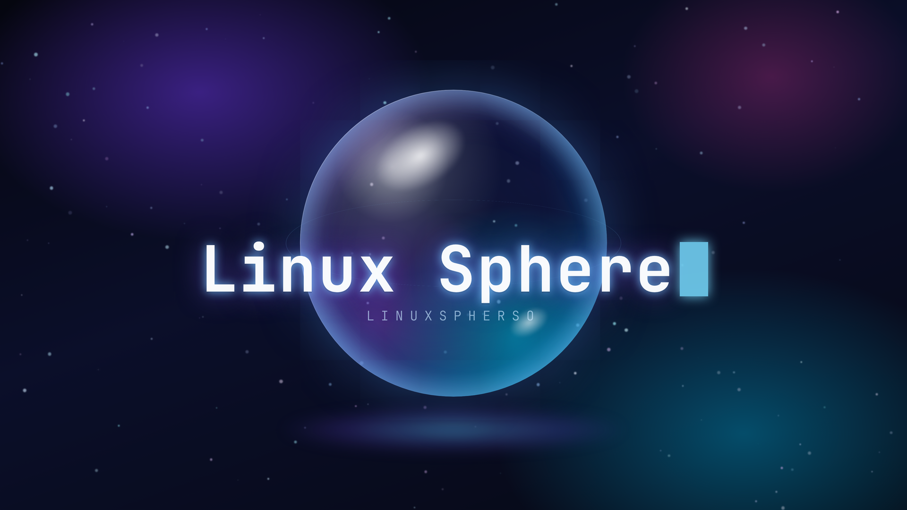

# LinuxSpherso 1.0 "Glass"

A Debian 13 (trixie) based Linux distro with a glass KDE Plasma 6 desktop.



## What's inside

| Feature | How |
|---|---|
| **GRUB bootloader** | `grub-efi` + `grub-pc` (UEFI and BIOS), Secure Boot shim, custom *linuxsphere* GRUB theme with the sphere wallpaper and JetBrains Mono font |
| **Advanced top bar** | Floating translucent (blurred) panel: Sphere Launchpad (full-screen app grid), global app menu, centered clock and date, live CPU/RAM/network graphs, virtual desktop pager, system tray, notifications, user switcher, lock/logout |
| **Smooth taskbar** | Floating, centered dock that sizes itself to its icons and slides away when a window touches it. KWin blur, wobbly windows, magic-lamp minimize, glide and sliding pop-ups, low-latency compositing, faster animations |
| **Start menu** | Kickoff with a custom glass-sphere "LS" icon, a grid of favorites, and category switching on hover |
| **Wallpaper** | Glass sphere with **Linux Sphere** in JetBrains Mono (a monospace terminal font). Also used on the login screen, lock screen, GRUB and the installer |
| **WinBoat** | Latest release from GitHub, plus Docker, docker-compose, FreeRDP 3 and KVM. Users are added to `docker` and `kvm` automatically |
| **Wine** | `wine` (32 + 64 bit), winetricks, Bottles |
| **Proton** | Steam, the latest GE-Proton already in every new user's Steam folder, ProtonUp-Qt, Lutris, GameMode, MangoHud, Vulkan |
| **Ubuntu app store** | Snap Store (installed automatically on first boot with internet) |
| **Debian app store** | GNOME Software (Debian's store) + Synaptic |
| **Linux Mint app store** | Mint Software Manager (`mintinstall`) from the LMDE 7 repo, pinned so it never replaces Debian packages |
| **KDE app store** | Discover (Flatpak + firmware) |
| **App formats** | `.deb`, `.rpm` (alien), Flatpak/Flathub, Snap, AppImage (Gear Lever), `.exe`/`.msi` (Wine/WinBoat), Android `.apk` (Waydroid), Arch `.pkg.tar.zst` and Fedora apps (Distrobox/Podman), `.sh`/`.run`, tarballs |
| **Installer** | Calamares with LinuxSpherso branding |

Double-click any package file, or run it in a terminal:

```
sphere-install some-app.rpm
sphere-install Game.AppImage
sphere-install setup.exe          # SPHERE_WINDOWS=winboat to open WinBoat instead
sphere-install org.gimp.GIMP      # Flathub id
```

## Build the ISO

You need a Debian 13 or Ubuntu 24.04+ machine (a VM is fine), root, about 25 GB free, and internet.

```bash
sudo ./build.sh
```

Without GE-Proton (about 500 MB smaller):

```bash
sudo WITH_GE_PROTON=0 ./build.sh
```

The output is `LinuxSpherso-amd64.hybrid.iso`. Flash it with Etcher or `dd`, or test it:

```bash
qemu-system-x86_64 -enable-kvm -m 8G -smp 4 -cdrom LinuxSpherso-amd64.hybrid.iso
```

Live user: `sphere` (no password). Use **Install LinuxSpherso** (Calamares) to install it to disk.

## Project layout

```
build.sh                     one-command build
auto/config                  live-build options (trixie, GRUB, ISO name, live user)
config/package-lists/        desktop, grub, gaming (wine/proton), winboat, appstores
config/hooks/live/           i386 + Steam, WinBoat, Mint store, Flatpaks, GE-Proton, branding, GRUB theme, Calamares
config/includes.chroot/      files copied into the OS (layout, KWin config, wallpaper, GRUB theme, sphere-install...)
artwork/                     wallpaper source (HTML) + rendered PNGs
```

To change the bars, edit
`config/includes.chroot/usr/share/plasma/look-and-feel/org.linuxsphere.desktop/contents/layouts/org.kde.plasma.desktop-layout.js`.

## Notes

- WinBoat needs hardware virtualization (VT-x/AMD-V) turned on in the BIOS. It runs a real Windows VM, so it is not useful inside the live session on low-RAM machines.
- Snap Store is installed on the first boot that has internet, because snaps can't be installed during the ISO build.
- The Mint store comes from Linux Mint's LMDE repo. If Mint's servers are down at build time, the build continues without it.
